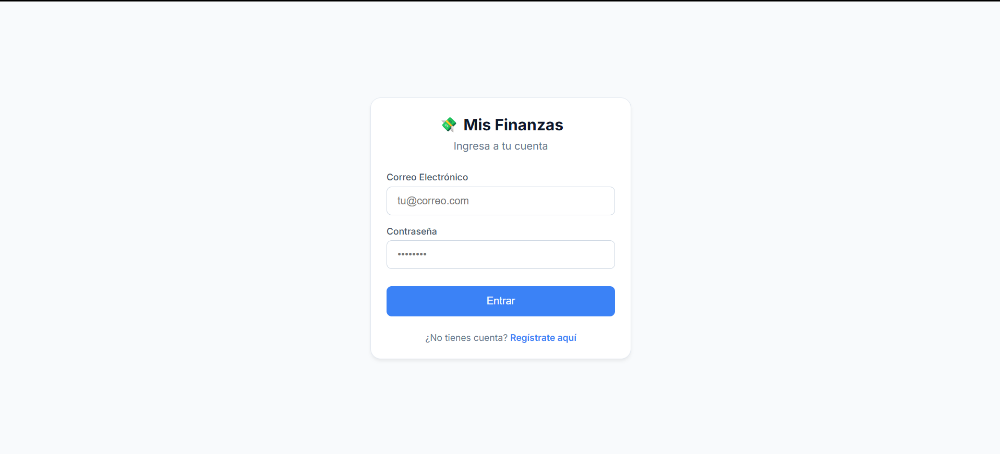
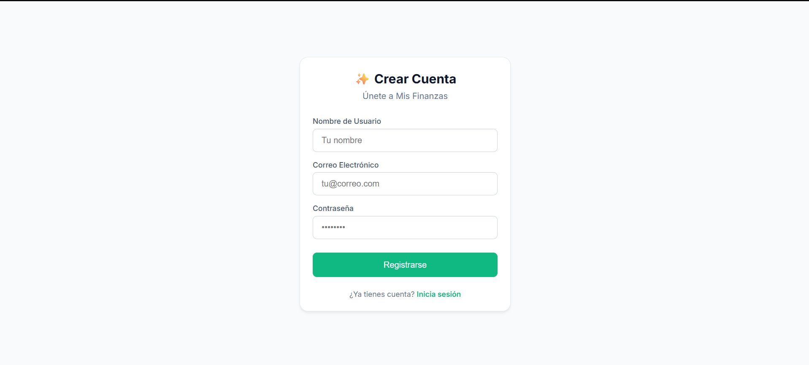
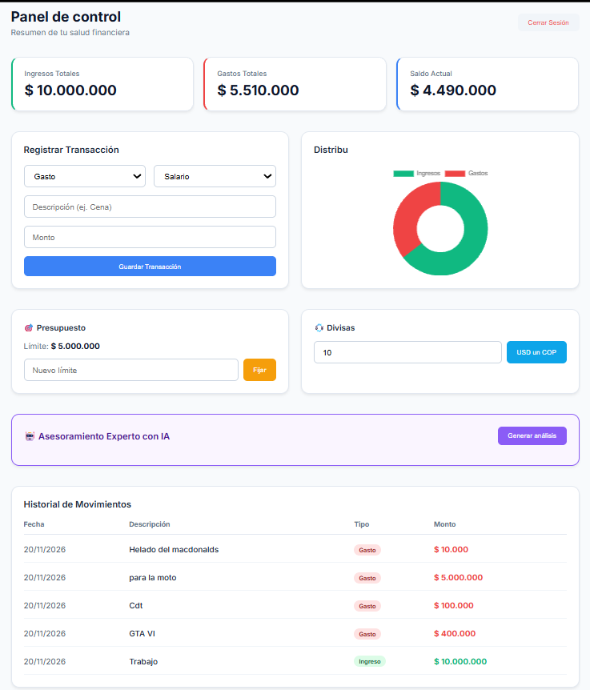
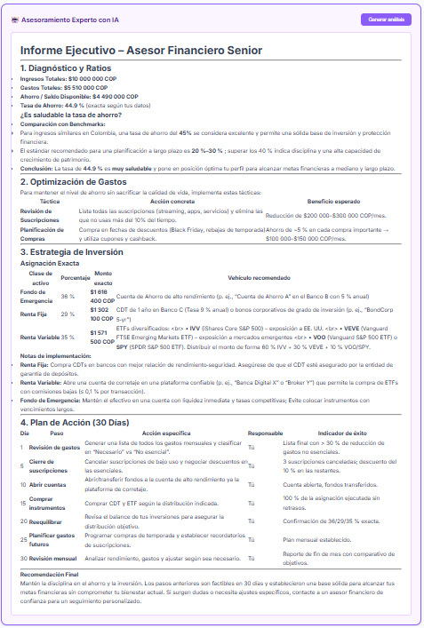

# 💸 Gestor de Finanzas Personales - Full Stack & AI

¡Bienvenido a mi proyecto de finanzas personales! Esta es una aplicación web Full-Stack diseñada para ayudar a los usuarios a tomar el control de su dinero mediante el registro de ingresos, gastos, presupuestos y análisis financiero impulsado por Inteligencia Artificial.

---

## 📸 Capturas de Pantalla


### 1. Inicio de Sesión


### 2. Crear cuenta


### 3. Dashboard Financiero y Gráficos


### 4. Asesoría con Inteligencia Artificial


---

## 🚀 Características Principales

- **Autenticación Segura:** Registro e inicio de sesión con encriptación de contraseñas y Tokens JWT.
- **Dashboard Interactivo:** Visualización de datos en tiempo real con gráficos dinámicos.
- **Gestión de Transacciones:** Registro de ingresos y gastos categorizados.
- **Presupuesto Mensual:** Definición de límites de gastos con sistema de alertas.
- **Asesor Financiero IA:** Integración con la API de Groq (Llama 3) para generar informes ejecutivos, recomendaciones de inversión (ETFs, CDTs) y tácticas de ahorro.
- **Conversor de Divisas:** Integración con ExchangeRate-API para convertir USD a COP en tiempo real.
- **Exportación de Datos:** Descarga del historial de transacciones en formato CSV y Excel.

---

## 🛠️ Tecnologías Utilizadas

**Frontend:**
- React.js (Vite)
- React Router DOM
- Chart.js & React-Chartjs-2
- React-Markdown
- Axios
- CSS3

**Backend:**
- Python 3.11
- Flask
- SQLAlchemy (ORM)
- Flask-JWT-Extended
- Groq API
- Pandas & OpenPyXL

**DevOps & Herramientas:**
- Docker & Docker Compose
- Git & GitHub
---
## 📂 Estructura del Proyecto

El proyecto está organizado de la siguiente manera:

```text
Proyectos_IWII/
│
├── app/                  # Backend (Flask)
│   ├── models/           # Modelos de Base de Datos (User, Transaction)
│   ├── routes/           # Rutas de la API (auth, transactions, dashboard)
│   ├── __init__.py       # Configuración de la App y Blueprints
│   └── config.py         # Configuración de variables de entorno
│
├── frontend/             # Frontend (React + Vite)
│   ├── src/
│   │   ├── App.jsx       # Enrutador principal
│   │   ├── Dashboard.jsx # Pantalla principal con gráficos e IA
│   │   ├── Login.jsx     # Pantalla de inicio de sesión
│   │   └── Register.jsx  # Pantalla de registro
│   └── package.json      # Dependencias de Node.js
│
├── docs/                 # Documentación OpenAPI
├── instance/             # Base de datos SQLite (No se sube a Git)
├── .env                  # Variables secretas (No se sube a Git)
├── .gitignore            # Archivos ignorados por Git
├── docker-compose.yml    # Configuración de Docker
├── Dockerfile            # Construcción de la imagen del Backend
├── requirements.txt      # Dependencias de Python
└── run.py                # Punto de entrada del Backend
``` 
---

## 🧑‍💻 Autores

- **Leonardo Guerrero** - *Estudiante de Ingeniería de Software y de Datos*
- **Karol Mape** - *Estudiante de Ingeniería de Software*
- **Sebastian Araque** - *Estudiante de Ingeniería de Software*

## 🔗 Enlaces del Proyecto

- [Perfil de GitHub de Leonardo](https://github.com/Leonardo29390)

- [Perfil de GitHub de Karol](https://github.com/karol-1711)
- [Perfil de GitHub de Sebastian](https://github.com/Araque08)